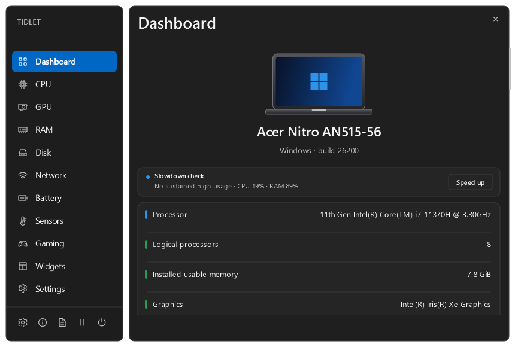
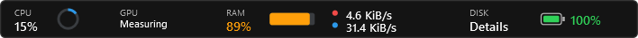
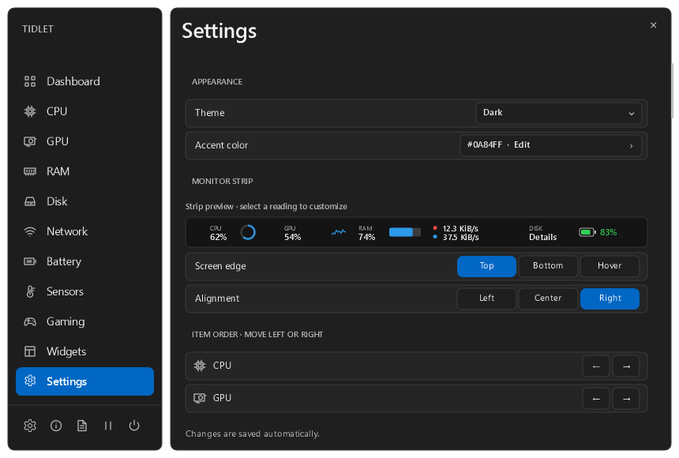
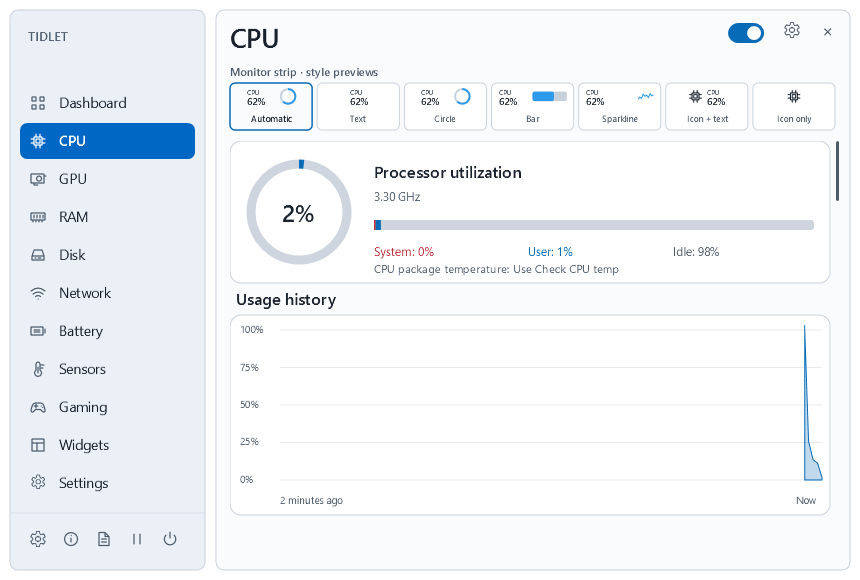
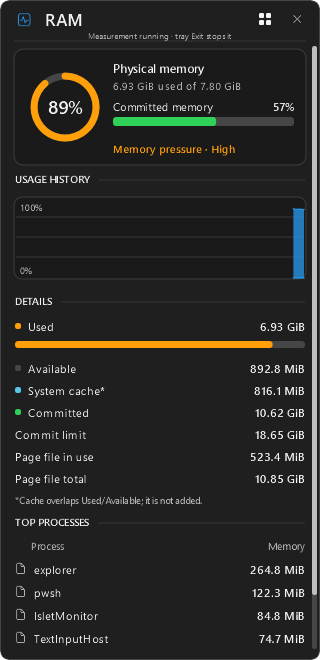
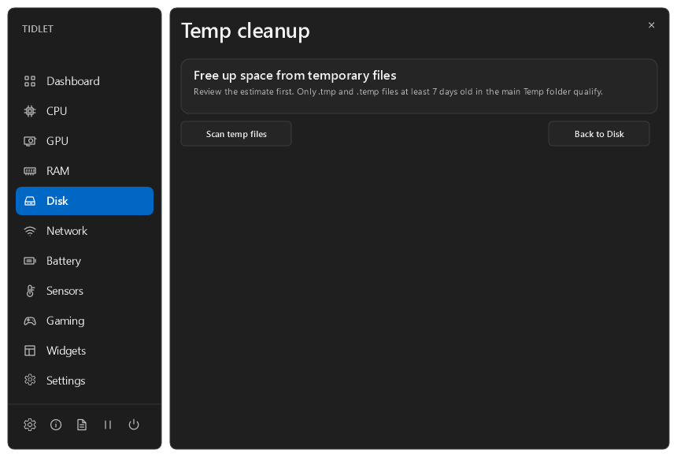
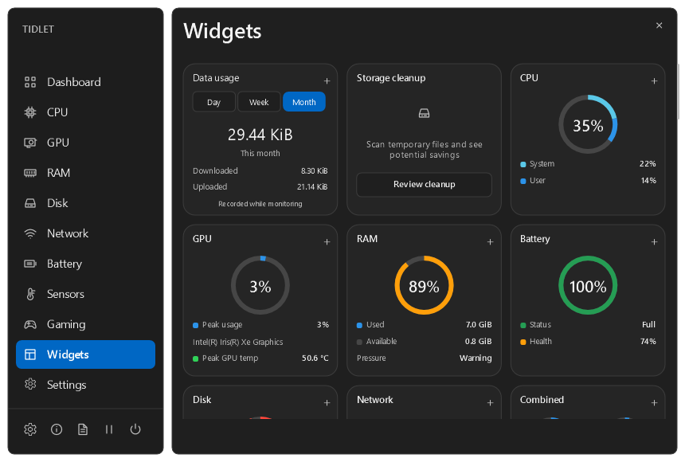
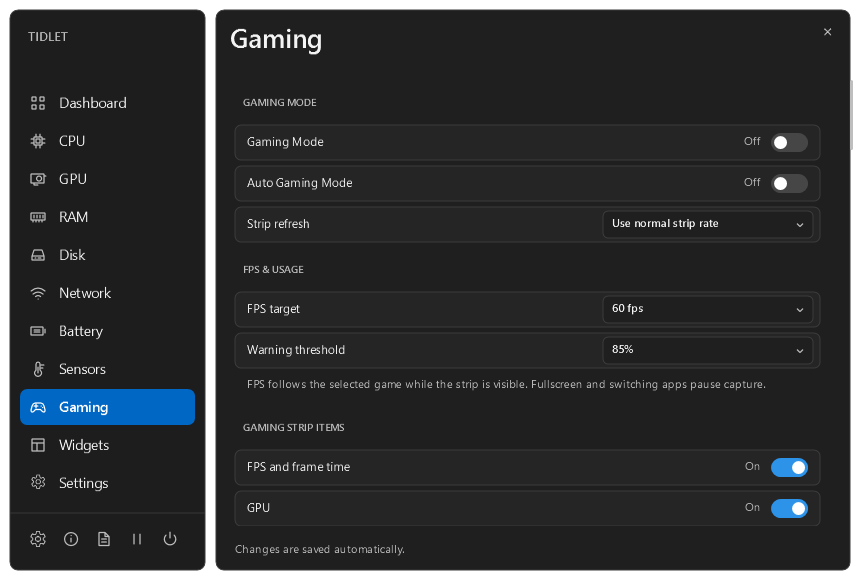

<h1 align="center">Tidlet Monitor</h1>

See how your Windows PC is doing from a compact strip, click-open popups, and desktop widgets.

  <a href="https://github.com/bawantha0528/Tidlet/releases/download/v0.1.0-preview/TidletSetup.exe"><strong>Download for Windows</strong></a>
  · <a href="https://github.com/bawantha0528/Tidlet/releases">Release notes</a>
  · <a href="#first-run">First run</a>
  · <a href="#compatibility">Compatibility</a>

## Download and install

1. Download [TidletSetup.exe](https://github.com/bawantha0528/Tidlet/releases/download/v0.1.0-preview/TidletSetup.exe).
2. Open it and follow the setup wizard. An all-users installation requests administrator approval. Tidlet normally runs with standard Windows permissions.
3. Launch **Tidlet Monitor** from Start. If an older copy is running, right-click its tray icon and choose **Exit Tidlet** first.

The download is **v0.1.0-preview**. The screenshots and instructions below show the current source build and include changes made after that installer was published. [Official preview release](https://github.com/bawantha0528/Tidlet/releases/tag/v0.1.0-preview)

## First run

- **Find Tidlet.** Look beside the Windows clock. Check **Show hidden icons** if needed. Right-click the Tidlet icon and choose **Open Dashboard**.
- **Explore a reading.** Click an item on the strip for a popup. Press **Esc** or click outside to close it.
- **Set up your layout.** Open **Settings → Monitor Strip** to choose where the strip appears. Open **Widgets** to pin readings to your desktop.

## Customize the monitor strip

| Placement | What to expect |
| --- | --- |
| **Top** | Tidlet reserves space above maximized windows when Windows can allocate it. |
| **Hover** | Move the cursor to the top edge to reveal the strip over open windows. |
| **Bottom** | The strip sits directly above the bottom taskbar. Choose Overlay or Reserve in Settings. |

Choose left, center, or right alignment and select your monitors. Click a sample reading in the preview to open its style settings. Use **← / →** to reorder items. Depending on the metric, you can choose text, icons, a ring, a bar, or a sparkline.

Under **Settings → Strip Colors**, click a swatch to pick a preset or enter a custom hex color. Restore individual colors or reset the full palette.

## Dashboard and popups

| Page | What you can see |
| --- | --- |
| **CPU** | Usage history, per-core load, clocks, and busy processes. Package temperature appears when supported. |
| **GPU** | Usage by adapter, dedicated memory capacity, and available temperatures. |
| **RAM** | Physical memory use, memory pressure, commit, page file, and top processes. |
| **Disk** | Read/write activity, capacity, and an on-demand drive health check. |
| **Network** | Upload and download speeds, adapter details, and on-demand Wi-Fi diagnostics. |
| **Battery** | Charge, health and capacity trends, available temperature, and supported Windows power modes. |
| **Sensors** | Read-only readings that your hardware and drivers expose. |

<table>
<tr><th>CPU Dashboard in light mode</th><th>RAM popup</th></tr>
<tr><td></td><td></td></tr>
</table>

## When your PC feels slow

- **Slowdown check.** The Dashboard shows live CPU and RAM readings and flags sustained high usage. Click **Speed up** for a suggestion and a shortcut to CPU or RAM details. If you need disk space, you can open the temporary-file review.
- **Sustained alerts.** In **Settings → Sustained Alerts**, enable Windows notifications and adjust the limits. The defaults are **90% CPU or RAM** and **15% battery while unplugged** for **two minutes**, with a five-minute cooldown. Alerts start off.
- **Wi-Fi diagnostics.** Open **Network → Run checks** to test the router, internet endpoint, and DNS separately.
- **Temporary files.** Open **Disk → Review cleanup → Scan temp files**. Review the estimated savings and confirm removal separately. Tidlet reports how many files were removed or skipped.
- **Battery care.** Review charge and capacity trends, select a supported Windows power mode, or find instructions for setting an 80% charge limit through your laptop manufacturer.

## Desktop widgets

Select **+** to pin a card, drag its title to move it, and select **×** to remove it. Tidlet remembers widget positions. Choose from CPU, GPU, RAM, Disk, Network, Battery, Combined, and Data usage.

**Data usage** shows day, week, and month totals recorded from eligible physical adapters while Tidlet is running. Totals include local traffic. Traffic from a hidden-strip interval can appear at the next counter read or normal exit.

## Gaming Mode

Use **Dashboard → Gaming** or the tray menu to switch the existing strip to your gaming layout. Choose which readings appear, the update interval, and the FPS target.

FPS needs the verified **PresentMon 2.6.0 x64** standalone executable beside Tidlet and Windows permission to capture frames. Focus the game when Gaming Mode starts. Switching away pauses capture, and fullscreen suppression can pause it as well. [PresentMon release assets](https://github.com/GameTechDev/PresentMon/releases/expanded_assets/v2.6.0)

## Compatibility

| System | Status |
| --- | --- |
| **Windows 11 on x64** | The x86 build has been tested on Windows 11 build 26200 on an Intel PC. |
| **Windows 10** | Intended for releases supported by .NET 8. Clean install and launch testing is pending. |
| **32-bit Windows 10** | Tidlet builds for x86. A native 32-bit test is pending. The FPS helper requires 64-bit Windows. |
| **Windows on Arm** | Windows supports x86 emulation. A Tidlet run on Arm and a native Arm64 build are pending. |

Basic monitoring needs no optional hardware driver. Temperature, battery health, and GPU metrics depend on the device and its drivers. CPU package temperature may require PawnIO and explicit approval for the helper. [Microsoft .NET compatibility](https://learn.microsoft.com/dotnet/core/install/windows#supported-versions) · [Windows on Arm](https://learn.microsoft.com/windows/arm/apps-on-arm-x86-emulation) · [PawnIO releases](https://github.com/namazso/PawnIO.Setup/releases)

## Privacy and support

- Settings and local readings stay on your PC. Tidlet uses no accounts, telemetry, cloud sync, or automatic update checks. Wi-Fi diagnostics contact network endpoints when requested.
- Settings live under **%APPDATA%\IsletMonitor**. Use **Settings → Export settings** to back them up or **Import settings** to restore them.
- If a reading is missing, open its Dashboard page for the availability message. To report an issue, export a compatibility report from Settings, review it, and attach it to a [GitHub issue](https://github.com/bawantha0528/Tidlet/issues).

## Build from source

Install the SDK pinned in [global.json](global.json) and the [x86 .NET 8 Desktop Runtime](https://dotnet.microsoft.com/en-us/download/dotnet/8.0). Run from the project folder:

~~~powershell
dotnet restore TidletMonitor.sln --locked-mode
dotnet build TidletMonitor.sln -c Release --no-restore
dotnet test TidletMonitor.sln -c Release --no-build
.\src\IsletMonitor\bin\Release\net8.0-windows\IsletMonitor.exe
~~~

The screenshots are rendered by the current app. See [Progress](PROGRESS.md) for validation results, [Performance](docs/PERFORMANCE.md) for measurement methods, and [Dependencies](docs/DEPENDENCIES.md) for optional components and licenses.

## License and credits

Tidlet Monitor is licensed under the [MIT License](LICENSE). UI inspired by [Stats (exelban/stats, MIT)](https://github.com/exelban/stats).
