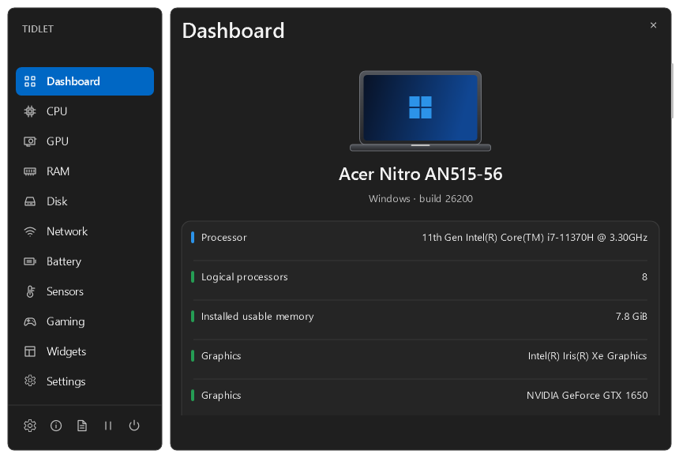
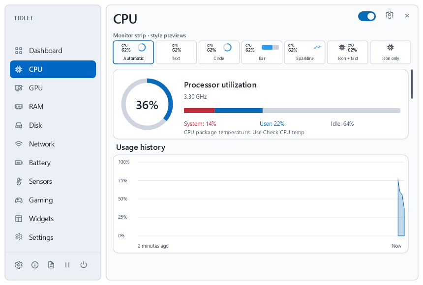
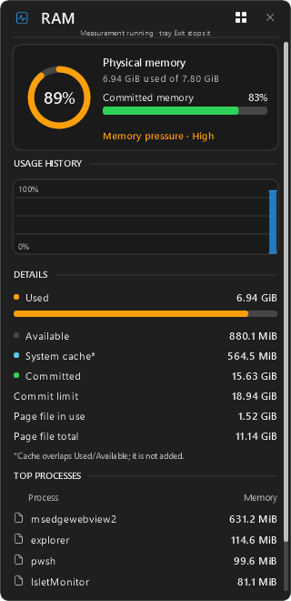

<p align="center">
  
</p>

<h1 align="center">Tidlet Monitor</h1>

<p align="center">A Windows system monitor with a compact strip, click-open details, and desktop widgets.</p>

<p align="center"><strong>Windows 10 / 11 · WPF · .NET 8 · MIT</strong></p>

<p align="center"><a href="#quick-start">Quick start</a> · <a href="#monitor-strip">Strip</a> · <a href="#dashboard-and-popups">Dashboard</a> · <a href="#widgets">Widgets</a> · <a href="#gaming-mode">Gaming</a></p>



## Quick start

Tidlet is currently available as a source build or local preview. The project produces an x86, framework-dependent Windows app. Install the **x86 .NET 8 Desktop Runtime**, including on x64 Windows. [Microsoft .NET 8 downloads](https://dotnet.microsoft.com/en-us/download/dotnet/8.0)

Build from the repository root with the SDK pinned in [global.json](global.json):

```powershell
dotnet restore TidletMonitor.sln --locked-mode
dotnet build TidletMonitor.sln -c Release --no-restore
.\src\IsletMonitor\bin\Release\net8.0-windows\IsletMonitor.exe
```

If Tidlet is already running, choose **Exit Tidlet** from the tray before opening a new build. Look beside the Windows clock, including under **Show hidden icons**, and choose **Open Dashboard**. Keep the executable and companion files together.

## Monitor strip


- Choose **Top**, **Bottom**, or **Top · reveal on hover**. Use **Overlay** or **Reserve** placement, and choose alignment and monitors in Settings.
- Click a strip item to open its popup. Right-click the strip or tray icon for quick controls.
- Enable items on their module pages and pick a style from the previews. Depending on the module, styles include text, rings, bars, sparklines, or icons.
- Open **Settings → Monitor strip** to preview your layout with sample readings and move items left or right. Battery is last by default. Your chosen order survives hiding and re-enabling items.
- Meters use blue or green for normal readings, orange for warnings, and red for critical readings. Network transfer colors distinguish upload and download.

## Dashboard and popups

| Module | What you can see |
| --- | --- |
| **CPU** | Usage, history, per-processor load, clocks, processes, and package temperature when available. |
| **GPU** | Per-adapter usage, dedicated capacity, and reported temperatures. |
| **RAM** | Physical usage, memory pressure, commit, page file, and top processes. |
| **Disk** | Read/write activity, volume capacity, and on-demand physical drive health. |
| **Network** | Up/down rates, local adapter details, and on-demand Wi-Fi checks. |
| **Battery** | Charge, capacity, health, reported temperature, trends, and supported power-mode controls. |
| **Sensors** | Available read-only GPU and storage sensors, including temperature, clocks and voltage. |

<table>
<tr>
<td></td>
<td width="27%"></td>
</tr>
</table>

- **CPU temperature.** Install PawnIO separately, then use **CPU → Check CPU temp** and approve the Windows prompt. An already-elevated Tidlet session can refresh temperature while the CPU page or popup is open. [Official PawnIO releases](https://github.com/namazso/PawnIO.Setup/releases)
- **Wi-Fi checks.** Open **Network → Run checks** to test router, Internet, and DNS separately. The checks run on request.
- **Storage cleanup.** Use **Disk → Review cleanup** or the Widgets card to scan eligible temporary files and review the estimated savings before confirming deletion.
- **Battery care.** Use the Battery page to review charge and full-charge capacity history, choose a supported power mode, or open the instructions for a manufacturer-provided 80% charge limit.

Missing readings depend on device, firmware, and permissions. Tidlet marks readings that are still warming up or unavailable.

## Widgets


Open **Widgets** in the sidebar for CPU, GPU, RAM, Disk, Network, Battery, Combined, and Data usage. Select **+** to pin a card to the desktop. Drag it by its title and use **×** to remove it. Tidlet remembers the desktop positions.

CPU, GPU, and Battery cards show temperatures where reported and follow **Settings → Temperature**. The CPU widget uses the most recent CPU package sample from the current session. The GPU widget shows the highest reported adapter temperature. Combined shows CPU and GPU temperatures when available.

The **Data usage** card supports **Day**, **Week**, and **Month**. It records traffic from eligible physical adapters while Tidlet is running. Totals include local traffic, and weeks start Monday.

## Gaming Mode


Use **Dashboard → Gaming** or the tray menu to switch layouts on the existing strip. The Gaming page controls auto activation, the FPS target, warning threshold, refresh interval, and which items appear.

FPS requires the official **PresentMon 2.6.0 x64 standalone executable** next to Tidlet. Tidlet verifies its release hash before launching it. Frame tracing requires Windows permission, so click **FPS** for details if it shows **Unavailable**. The strip follows its usual fullscreen hiding policy. [PresentMon release assets](https://github.com/GameTechDev/PresentMon/releases/expanded_assets/v2.6.0)

## Privacy and compatibility

Tidlet keeps preferences and local readings under `%APPDATA%\IsletMonitor` or in memory, depending on the feature. There are no accounts, analytics, cloud sync, or automatic update checks. Routine monitoring runs under a standard Windows account. **Settings → Export settings** saves preferences, and **Compatibility report** creates a local JSON file you can review before sharing.

## Development and validation

- `src/Islet.Core` contains portable settings, capabilities, and metric calculations.
- `src/Islet.Shell` contains WPF strip, popup, Dashboard, and widget presentation.
- `src/Islet.Windows` contains Windows interop and hardware providers.
- `src/IsletMonitor` contains app startup and composition.
- `tests` and `scripts` contain automated checks, render probes, and measurement tools.

The images above are application render exports. See [PROGRESS.md](PROGRESS.md) for measured builds and open verification gaps, [PERFORMANCE.md](docs/PERFORMANCE.md) for the resource methodology, and [AGENTS.md](AGENTS.md) for the engineering agreement.

## License and credits

Tidlet is licensed under the [MIT License](LICENSE). UI inspired by Stats (exelban/stats, MIT). [Stats repository](https://github.com/exelban/stats)

Optional hardware and FPS integrations use LibreHardwareMonitor, PawnIO, and PresentMon. See [dependency and license notes](docs/DEPENDENCIES.md).
