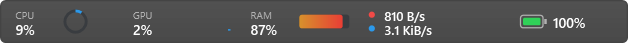

<p align="center">
  
</p>

<h1 align="center">Tidlet Monitor</h1>

<p align="center">Live PC readings in a compact Windows strip, with click-open details and a full Dashboard.</p>

<p align="center">Windows 10 / 11 · .NET 8 · WPF · MIT</p>

<p align="center"><a href="#quick-start">Quick start</a> · <a href="#what-you-can-monitor">Modules</a> · <a href="#using-tidlet">Controls</a> · <a href="#validation-and-performance">Validation</a> · <a href="#development">Development</a></p>


<p align="center">
  
</p>

Tidlet runs in the notification area. Keep an eye on usage from the strip, click a reading for a popup, or open the Dashboard for wider charts and hardware details. The same layout is available in **Dark** and **Light**.

## Quick start

Tidlet is under active development. Use the local preview or build the source. The checked-in project currently produces an x86, framework-dependent Windows app.

**Requirements**

- Windows 10 or 11 with support for x86 desktop apps. Native preview verification is currently on Windows 11.
- The **x86 .NET 8 Desktop Runtime**, even on an x64 PC. Choose **Desktop Runtime → Windows → x86**. [Microsoft .NET 8 downloads](https://dotnet.microsoft.com/en-us/download/dotnet/8.0)
- The SDK pinned in [global.json](global.json) for source builds.

### Run a local preview

Exit any running Tidlet from the tray menu, then run the audited preview if it has been built locally:

```powershell
.\src\IsletMonitor\bin\startup-complete-final\IsletMonitor.exe
```

Look near the clock, including under the **^** hidden-icons arrow. Right-click Tidlet and choose **Open Dashboard**. Keep the executable and its companion files together.

### Build from source

Run from the repository root in PowerShell:

```powershell
dotnet restore TidletMonitor.sln --locked-mode
dotnet build TidletMonitor.sln -c Release --no-restore -p:OutputPath=bin/ui-audit/
.\src\IsletMonitor\bin\ui-audit\IsletMonitor.exe
```

## What you can monitor

| Module | Readings |
| --- | --- |
| **CPU** | Utilization, history, logical processors, frequency when reported, and top processes. |
| **GPU** | Optional live strip reading, per-adapter utilization and dedicated capacity where supported. |
| **RAM** | Physical usage, memory pressure, commit and page-file readings, and top processes. |
| **Disk** | Physical read/write activity and fixed-volume capacity. |
| **Network** | Traffic rates and session totals from eligible physical adapters. Red is upload and blue is download. |
| **Battery** | Charge, power source, and reported health and capacity. The Dashboard also provides Windows power-mode controls where available. |
| **Sensors** | Capability status for advanced readings that require an optional helper. |

On startup, the strip shows **Measuring** for readings that need more time. Popups and Dashboard pages show available details such as graphics adapters and disk space while rate counters warm up. Recent readings are marked during refresh, and missing or unsupported readings show a reason.


## Using Tidlet

| Task | Where to find it |
| --- | --- |
| Open a detail popup | Click a strip reading. Scroll for more, then press **Esc** or click outside to dismiss. |
| Move the strip | Right-click the tray icon or use **Settings → Position**. Choose top, bottom, or **Top · reveal on hover**. |
| Choose a placement mode | Use **Overlay** to float above the desktop or **Reserve** to request space from Windows. |
| Switch themes | Open **Settings → Theme** and pick **Dark**, **Light**, or **System**. System reads the Windows app theme when Tidlet applies its appearance. |
| Choose or reorder readings | Toggle a module from its page or under **Settings → Modules**. Use **Move earlier in strip** to reorder it. Re-enabled items return to their saved position. |
| Pick a strip style | Open a module page and click a preview under **Monitor strip**. Available styles depend on the reading and include text, icons, circles, bars, sparklines, and network up/down rates. Tidlet saves each module's choice separately. |
| View live widgets | Open **Widgets** in the app sidebar for CPU, GPU, RAM, disk, network, and a combined card. Click an individual card for its full module page. The Widgets page refreshes every three seconds while open. |
| Place widgets on the desktop | In **Widgets**, choose **+** on a card. Drag the card by its title and use **×** to remove it. Tidlet remembers the positions in its local data folder and restores the cards on launch. |
| Check data usage | Open **Widgets → Data usage** and choose **Day**, **Week**, or **Month**. Totals combine uploads and downloads across monitored physical adapters, including local network traffic. The week starts Monday. Tidlet keeps daily totals locally and only records traffic while monitoring is running. |
| Diagnose Wi-Fi | Open **Network → Run checks**. Tidlet tests the local router, a public HTTPS port over the Wi-Fi IPv4 address, and Windows DNS separately. These checks run only when requested. |
| Check or clean up storage | Use **Disk → Check health** for physical drive status reported by Windows. Open **Review cleanup** from Disk or the Storage cleanup card in Widgets. Scan to see the amount inspected and the estimated reclaimable space. Review and explicitly confirm before permanently deleting eligible files. |
| Review battery trends | The **Battery** page shows a rolling two-minute charge chart and up to 31 days of daily full-charge capacity readings when the battery reports capacity. |
| Change Windows power mode | In **Dashboard → Battery**, choose a mode for the displayed power source. **Windows settings** opens the system page when needed. |
| Set an 80% charge limit | In **Dashboard → Battery**, open **80% charge limit** for setup steps. The manufacturer's utility applies the limit on supported models. |
| Pause or quit | Use the tray menu. Settings remain accessible while paused. |
| Export or restore preferences | Use **Settings → Export settings** or **Import settings**. Changes save automatically. |

### Troubleshooting

**Tidlet opened without a window.** Open the Dashboard from the tray. A fullscreen app, an empty strip layout, or the hover-reveal setting can hide the strip.

**The previous UI is still visible.** Exit the running instance before opening the new build. Tidlet allows one normal instance at a time.

**A reading is missing.** Battery hardware, GPU counters, and sensor access vary by device. Rate-based readings can also take a second sample to appear.

**Reporting a problem.** Include the Tidlet build, Windows version, display scale, affected module, and steps to reproduce. **Settings → Compatibility report** saves a local JSON file you can review before sharing.

## Privacy

Tidlet processes readings locally. It has no accounts, analytics, cloud sync, automatic update checks, or public-IP lookup. Preferences, exports and compatibility reports live under `%APPDATA%\IsletMonitor`. Recent readings are cached in memory for the current session. Routine monitoring runs with standard user permissions.

## Validation and performance

Performance figures apply to the listed builds and scenarios. RAM is peak whole-process working set in decimal MB. CPU is average machine-normalized usage over the observation.

| Build and scenario | Peak RAM | Avg. CPU | Result |
| --- | ---: | ---: | --- |
| Monitor-only Release, GPU bar | 76.80 MB | 0.042% | Passed. [Evidence](docs/MONITOR_ONLY_CLEANUP.md) |
| Charcoal bottom strip, live GPU | 78.15 MB | 0.055% | Passed with popups closed. [Evidence](docs/CHARCOAL_MONITOR_STRIP.md) |
| Earlier Dashboard navigation | 91.39 MB | 0.120% | Passed the application budget. [Evidence](docs/R4_APP100_VALIDATION.md) |
| Light strip with popups opened during observation | 94.71 MB | 0.208% | Exceeded the cap and invalid for bar-only acceptance. [Evidence](docs/LIGHT_MODE.md) |

The current limits are **90 MB** for fresh bar or popup sessions, **100 MB** lifetime for Dashboard sessions, **90 MB** current working set after Dashboard close, and **under 1%** average machine CPU over five minutes. The current preview passed 143 tests in each architecture configuration and 40 x86 render checks across both themes. Fresh five-minute acceptance is pending. Repository images are application render exports. Physical mixed-DPI, broader Windows 10 coverage, and real fullscreen-game testing remain open. [Current UI audit](docs/UI_AUDIT.md)

## Development

| Folder | Responsibility |
| --- | --- |
| `src/Islet.Core` | Portable settings, capabilities, and metric calculations. |
| `src/Islet.Shell` | WPF strip, popup and Dashboard presentation. |
| `src/Islet.Windows` | Windows interop, hardware providers, and action boundaries. |
| `src/IsletMonitor` | Application startup and composition. |
| `tests` and `scripts` | Unit tests, read-only render probes, and performance harnesses. |

```powershell
dotnet test TidletMonitor.sln -c Release --no-build --no-restore -p:OutputPath=bin/ui-audit/
powershell -NoProfile -File scripts/smoke-ui.ps1 -Executable src/IsletMonitor/bin/ui-audit/IsletMonitor.exe
```

See [engineering rules](AGENTS.md), [progress](PROGRESS.md), [decisions](DECISIONS.md), and [performance methodology](docs/PERFORMANCE.md).

## License and credits

[MIT License](LICENSE). UI inspired by Stats (exelban/stats, MIT). [Stats repository](https://github.com/exelban/stats)
