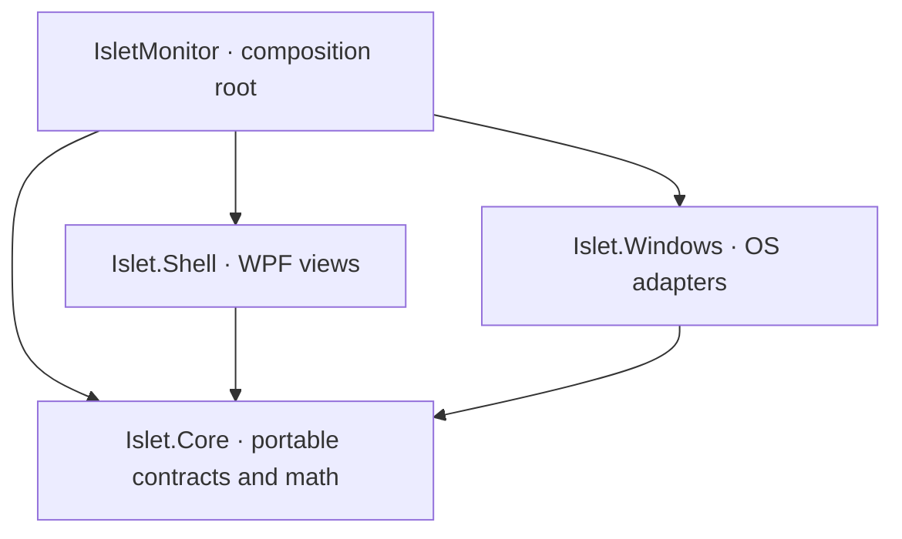

# Tidlet Monitor — detailed M0–M3 implementation plan

> Latest user instruction overrides this historical plan: use only `C:\Users\bawan\OneDrive\Documents\Tidlet` for active development. The user commits manually every time. No automatic staging, commits, Git initialization or pushes. Any commit sequences below are suggestions for the user, not agent actions.

Planning snapshot: 29 October 2026 (Asia/Colombo). This plan predates implementation. **M0 implementation and executed evidence are now tracked in PROGRESS.md; statements below describing the empty starting state are historical.**

This document is the plan requested before feature code. It describes work to be performed, not implemented behavior or passing results. No application, tests, benchmark, remote CI run or commit exists yet.

## 1. Outcome and scope boundary

Deliver a small, local-only Windows monitor for everyday users: a quiet top-edge island with one useful live number, an informative hover view, and a readable expanded panel. All hardware features are capability-driven, so unsupported sensors disappear from the default layout and remain explainable in settings.

Implement only:

| Milestone | Deliverable | Primary gate |
|---|---|---|
| M0 | Buildable repository and repeatable verification/measurement | Release build and actual nonempty tests; actual CI separately evidenced |
| M1 | Working transparent island/notch/bar shell | Real interaction/DPI checks and measured WPF feasibility |
| M2 | Tier 1 metrics and widgets with graceful degradation | Validated math, failure fixtures, adaptive lifecycle, budgets with real providers |
| M3 | Customization, persistence, profiles and threshold alerts | Restart/recovery/import tests and post-customization budget checks |

Stop after the M3 report and wait for review. M4 compatibility export/ARM64/helper, M5 diagnostics/fixers, M6 creature and M7 installer/release/signing/winget/MSIX are deferred. M0–M3 may define small inert schemas for future mood/fixer data; no executable fixer engine or creature behavior. Plain-English M2 explanations describe readings and limitations; they must not pretend to diagnose a root cause or offer unfinished M5 fixes.

“Any laptop or desktop” means graceful operation and truthful capabilities across tested configurations. It cannot mean every sensor works on every device or that one test machine proves universal compatibility. Use x64 for the first live execution/benchmark and include x86 build/native-layout checks so 32-bit Windows 10 is not silently excluded. Actual x86 execution requires the matching desktop runtime and remains untested until run. ARM64 delivery belongs to M4. Keep ABI code pointer-size correct; do not substitute a successful AnyCPU build for both architectures.

## 2. Observed starting point and gates before implementation

Read-only environment checks ran on this date:

- The requested `C:\Users\bawan\OneDrive\Documents\Tidlet` directory appeared empty. `git status --short --branch` reported that it is not a Git repository.
- `dotnet --list-sdks` succeeded and listed 8.0.414, 10.0.201 and 10.0.401.
- `dotnet --list-runtimes` succeeded and included .NET 8.0.20 and Windows Desktop 8.0.20.
- `dotnet --info` printed installed tools but also failed in workload inspection because access to Service Control Manager was denied. This is not evidence that normal builds fail; build capability remains untested.
- Creating files/directories in the requested OneDrive folder failed with file-not-found errors through patching, PowerShell, an explicitly approved unsandboxed attempt, and the file runtime. Cause unverified; do not label it a Defender/OneDrive diagnosis without evidence.
- File creation succeeded in this chat's separate writable output directory. Planning artifacts are preserved there. The requested repository has not been created or modified.

No build, test, app launch, benchmark, settings change, package installation, Git initialization or remote CI run has been performed.

Implementation gates:

1. A workspace that actually accepts file creation. Retry only after a meaningful environment change; do not change security settings or keep cycling equivalent write attempts.
2. Explicit approval for the proposed test-only dependencies in `DECISIONS.md`. No production NuGet dependency is proposed.
3. Pin the .NET 8 SDK; never accidentally build with the default .NET 10 SDK. Use the installed 8.0.414 first; verify the official current servicing SDK before choosing a CI pin. Do not install/upgrade machine-wide tools without approval.
4. Keep the requested .NET 8 target. Its support ends **10 November 2026**, according to [Microsoft's current support policy](https://dotnet.microsoft.com/en-us/platform/support/policy). Record this as a release/support risk; moving to .NET 10 would require a scope decision, not an autonomous stack substitution.
5. Official .NET OS lifecycle support is narrower than functional Windows 10 compatibility; test ordinary Windows 10 behavior separately from Microsoft servicing claims. [Official Windows support/architecture table](https://learn.microsoft.com/en-us/dotnet/core/install/windows). Real mixed-DPI monitors, Windows 10 hardware, an 8 GB system and hybrid-GPU hardware are not confirmed available. Maintain separate “not tested” rows until physically exercised.

## 3. Repository and dependency direction

Planned structure:

```text
TidletMonitor.sln
global.json
Directory.Build.props
Directory.Packages.props          # only approved test package pins
.editorconfig
.gitignore
AGENTS.md
PLAN.md
PROGRESS.md
DECISIONS.md
LICENSE
README.md
.github/workflows/build-test.yml
src/
  Islet.Core/
    Capabilities/ Metrics/ Settings/ Themes/ Profiles/ Alerts/
    Widgets/ Fixers/ Moods/
  Islet.Shell/
    Island/ Animation/ Widgets/ Settings/ Themes/ Accessibility/
  Islet.Windows/
    Interop/ Metrics/ Display/ Power/ Fullscreen/ Tray/
    Hotkeys/ Processes/ Storage/
  IsletMonitor/
    App.xaml App.xaml.cs app.manifest
tests/
  Islet.Core.Tests/
  Islet.Shell.Tests/
  Islet.Windows.Tests/
  Fixtures/
scripts/
  measure.ps1
  verify-test-results.ps1
docs/
  IMPLEMENTATION_PLAN.md
  API_REGISTER.md
  ACCEPTANCE_MATRIX.md
  PERFORMANCE.md
  evidence/
```

Dependency graph:



- Core targets `net8.0`. Shell and app use the .NET 8 Windows Desktop SDK; Windows targets `net8.0-windows`. Select a versioned Windows target only if a verified API requires it.
- Shell does not directly call native functions or reference Windows implementation types. App wires platform implementations into portable interfaces.
- Put `IWidget` in Shell because its `View` is WPF. Core holds only `WidgetDescriptor`, values and provider contracts.
- Built-in .NET JSON, async/cancellation, collections and networking; built-in WPF drawing and bindings; handwritten small verified Win32 bindings. No chart, MVVM, DI, theme, icon, settings, notification or hardware library.
- Prefer native PDH over a new managed performance-counter package. Prefer verified native battery APIs over introducing a WinRT projection package. Native interop tradeoffs and structure checks must be documented.
- Use manual composition and small view models. A general plugin system, scripting host and arbitrary external theme code are out of scope.
- Record and lock approved transitive test dependencies. Test packages never flow into the app's published output.

## 4. Portable contracts, lifecycle and data semantics

### 4.1 Capability contracts

Every provider exposes asynchronous, cancellable startup probing and disposable lifetime management. Probing runs off the UI thread with bounded concurrency and per-provider timeout.

A capability is per device **and per field**, not just per provider. A battery can support percentage while reporting no design capacity. A GPU may expose its identity while exposing no counters.

Startup result:

- `Supported`: enough usable evidence for the capability, including counter warmup where required.
- `Unsupported(reasonCode, plainEnglishReason)`: absent hardware/API/counter or unavailable permission. Reasons distinguish “no battery,” “Windows did not supply this value,” and “access denied.”
- `NeedsHelper(reason)`: richer hardware sensors require the future optional helper. No installation or elevation offer before M4.

Runtime sample envelope:

- Metric/device identity, UTC timestamp, monotonic sampling interval, units, typed value, quality and source.
- States: available, warming up, temporarily unavailable, stale, invalid. Last good value may remain dimmed with its age; it must never masquerade as current.
- A genuine measured 0 is valid. An unavailable measurement has no numeric value.
- Re-probe only on relevant hardware/power/network changes or bounded exponential backoff; no constant expensive startup-probe loop.

### 4.2 Math and validation

- Use monotonic elapsed time for rates; wall-clock adjustments cannot create spikes.
- First counter observation establishes a baseline. Counter decreases, device replacement, invalid elapsed time and sleep/resume reset it.
- Reject NaN, infinity, negative capacities/byte counts where impossible and internally inconsistent totals.
- Clamp valid percentage display results to 0–100 for small arithmetic/rounding excursions; do not clamp grossly invalid raw data into a convincing reading.
- Battery health requires positive design/full-charge values with identical units. Missing, zero, sentinel, corrupt or clearly impossible values become unavailable. Slightly above-design OEM readings must retain their provenance and avoid a false health diagnosis. Document the plausibility policy and fixtures before implementation; there is no assumed universal OEM tolerance.
- Store bounded history: initially 60 expanded samples per plotted series. Missing intervals form gaps rather than false zeroes. No unbounded process/device/adapter histories.
- All labels specify units: CPU %, physical RAM %, MiB/GiB, bytes/s formatted as KB/MB or KiB/MiB consistently, RTT/jitter ms, battery mW/mWh.
- Use stable device identity (interface LUID, adapter LUID, physical disk instance plus topology generation). Process identity includes PID and creation time.

### 4.3 Polling ownership

One central scheduler owns sampling; widgets do not create timers.

- Expanded: 1-second sampling for visible subscribed metrics; publish at most one UI update per batch.
- Collapsed: 4 seconds by default, within the required 3–5-second range, and only the selected live statistic.
- Hover: mini-widget subscriptions only, initially 2 seconds; lifetime ends when leaving hover.
- Hidden, fullscreen suppression, display off, session locked or suspend: cancel metrics, graph work and animations. Only minimal OS notifications/fullscreen reconciliation remain.
- Battery saver: slow visible expensive metrics to a documented cadence; collapsed may use 5 seconds. A closed laptop lid slows or pauses according to whether an external display remains active, with unknown lid state handled safely.
- Resume/reappear: reset deltas, warm up and refresh once; do not show a giant accumulated network/process CPU spike.
- At most one in-flight read per provider. Skip a late tick; never accumulate queued work. A slow provider cannot delay unrelated metrics.
- Bounded retry/backoff, explicit disposal, cancellation and subscription-count tests.
- Alerts/profile rules consume existing samples by default. An explicitly enabled alert may subscribe to the minimum necessary sensor while visible; it cannot restart hidden polling.

## 5. M0 — repository scaffold and verification foundation

### Work packages and order

**M0.1 — usable workspace and foundation**

- Once file creation works, place AGENTS/plan/decisions/progress into the requested repository.
- Initialize local Git if no repository exists; no guessed remote or publication. Preserve existing identity/configuration; do not change global Git settings.
- Add MIT license with project-contributor attribution, README status/scope/privacy skeleton and EditorConfig.
- Add .gitignore for build output, local settings, benchmark raw environment files and accidental battery reports; intentionally curated evidence may be committed.
- Document no telemetry/local-only operation, the .NET 8 support date, framework-dependent developer runtime requirements and current hardware coverage.

**M0.2 — solution and reproducible build**

- Pin verified .NET 8 SDK in global.json. Nullable references, consistent language settings and analyzers already included in the SDK; no analyzer package.
- Create four projects and the directed project references above. Add x64 and x86 build/native-layout checks; defer ARM64 as requested. Add a minimal runnable app bootstrap so M0 can have an honest scaffold baseline; no island feature yet.
- Verify native/WPF code cannot enter Core using project-reference checks and a meaningful architecture test.
- Add approved test projects; mark their package references private. Avoid optional coverage/benchmark/GUI-automation packages.
- Restore only approved packages, inspect the lock graph and licenses, and verify publish output has no test dependencies.

**M0.3 — real tests and CI**

- Add meaningful scaffold tests: capability/result invariants, reference direction, schema default validity and measurement-summary arithmetic/failure fixtures where appropriate.
- `dotnet test` must discover and execute tests. Capture TRX, assert nonzero discovered count, and fail on test failure or missing expected results.
- Configure GitHub Actions on a verified Windows runner, with pinned supported action revisions, read-only repository permissions, .NET 8 setup, restore/build/test and TRX retention. Verify runner/action versions in official GitHub sources before writing workflow pins.
- Configure build/test process telemetry opt-out locally and in CI through child-process environment only; do not modify user/system environment settings.
- Remote workflow configuration is not a CI pass. M0's CI gate remains open until an actual run URL/status exists on an authorized repository.

**M0.4 — measurement harness**

Implement `scripts/measure.ps1` per section 9. Validate formulas with deterministic fixtures, then observe the runnable scaffold for 300 seconds. Deliberately test invalid PID, early exit and incomplete samples without terminating real processes. A short-lived owned fixture may exit naturally.

### Verification commands to run

```powershell
dotnet --version
dotnet restore TidletMonitor.sln --locked-mode
dotnet build TidletMonitor.sln -c Release --no-restore
dotnet test TidletMonitor.sln -c Release --no-build --logger "trx"
pwsh -NoProfile -File scripts/verify-test-results.ps1
pwsh -NoProfile -File scripts/measure.ps1 -ProcessId <scaffold-pid> -Scenario ScaffoldIdle -DurationSeconds 300
```

Also run the user's plain `dotnet build -c Release` and `dotnet test` at the repository root once to prove the documented defaults work.

### M0 exit gate

Release build and real tests pass locally; harness evidence exists; remote CI passes or is explicitly pending external setup. A scaffold measurement is labeled **scaffold baseline**, never a passed collapsed island budget. Update PROGRESS and commit. Continue independent work with explicit CI/hardware gaps, but do not declare the milestone fully accepted while required evidence is missing.

## 6. M1 — island shell and early WPF feasibility gate

### M1.1 — state model and geometry

- Separate presentation states (Collapsed, Hover, Expanded) from suppression (user hidden, fullscreen, lock, display off, suspend). Suppression takes precedence.
- Define deterministic enter/leave/click/tray/hotkey transitions; Escape returns from an explicitly opened panel; outside interaction collapses without stealing focus.
- One island on the primary monitor by default, user-selected monitor thereafter. No duplicate per-monitor metric collectors.
- Island: small floating pill with an initial 8-DIP gap. Notch: top edge flush, custom symmetric path with flared top corners. Bar: compact horizontal strip. Exact default dimensions/corner radii are design decisions, bounded to the display.
- Generate shape geometry from shared parameters and freeze reusable brushes/geometries. Keep window bounds close to visible content, not a full-screen transparent surface.
- Initial motion: finite 250 ms eased transitions, interruptible from current visual state; no endless animation clocks.
- Add the smallest real CPU provider (or RAM if CPU is unavailable), with startup probe, validated values and a 4-second cadence, for the required live collapsed stat. Reuse and standardize it in M2. M1 acceptance must not benchmark fabricated live-stat updates.

### M1.2 — native window behavior

- Borderless transparent WPF window, topmost in the ordinary user desktop, `ShowActivated=false`, no taskbar entry, `WS_EX_NOACTIVATE | WS_EX_TOOLWINDOW`.
- Native integration initializes only after HWND creation; check every native result and preserve existing style bits.
- Settings, keyboard-accessible details and process-confirmation dialogs are normal explicitly opened windows. They may activate after user action; the ambient island never unexpectedly activates.
- True collapsed layered-window click-through uses verified cross-process behavior. Do not mistake WPF `IsHitTestVisible=false` or `HTTRANSPARENT` for universal click-through.
- Collapsed click-through and mouse expansion conflict: use a bounded visible-only pointer-position observer (initially 100 ms, to be benchmarked). Entering the island bounds transitions to Hover, which becomes interactive; the next click can open Expanded in click-expansion mode. In hover-expansion mode, dwell opens the configured view. No input interception or swallowing the underlying click while still collapsed.
- Tray “Open” always provides recovery. Register the default hotkey in M1 (planned Ctrl+Alt+I, subject to conflict handling); M3 makes it configurable.
- No global low-level mouse hook by default. Disable the pointer observer while hidden/fullscreen. If it misses budgets, report the conflict and measured cost; do not silently drop either requirement.

### M1.3 — display, DPI and fullscreen lifecycle

- Manifest per-monitor-v2 DPI awareness. Centralize physical-pixel/DIP conversion, signed coordinates, work area and monitor identity.
- Respond to DPI change, display topology change, taskbar/work-area change, selected-monitor removal and Explorer tray restart.
- Reposition to a valid monitor on unplug/restart; preserve user placement preference for reconnect.
- Use `SHQueryUserNotificationState` as required, including busy/presentation and exclusive-D3D suppression. It is not a documented exhaustive per-monitor fullscreen detector.
- Use foreground/location WinEvents to trigger reevaluation, with bounded low-frequency reconciliation for transitions that emit no suitable event. Verify each candidate native API before implementing.
- Borderless fullscreen requires a tested foreground-window/monitor-bounds heuristic in addition to notification state. Document limitations for spanning windows, multiple monitors, games, video and remote sessions.
- Close/suspend and resume paths dispose/recreate notifications safely; no metrics or frame work while suppressed.

### M1.4 — rendering and accessible interaction

- Demand-driven render invalidation at rest; one collapsed stat may redraw when its 4-second value changes. “Render only while animating or expanded” means no continuous frame loop while collapsed.
- Detach any `CompositionTarget.Rendering` listener on transition completion and hide. Clear unneeded clocks/subscriptions.
- Use built-in vector icons/drawing, short labels, high-contrast-friendly text, accessible names, reduced-motion option and keyboard route through tray/normal panel.
- Avoid continuous blur effects, large shadow surfaces and animated graph placeholders. Expanded graphs redraw when data changes, not automatically at display refresh rate.

### M1 verification and gate

Automated: state transitions/interruption/suppression precedence, path/placement bounds, signed monitor coordinates, DPI conversion, timer cancellation, shell window-style application through mock native adapters, accessible property smoke checks on STA.

Manual on actual desktop: three styles × three states; foreground HWND unchanged by ambient transitions; Alt+Tab/taskbar absence; clicks reach an underlying separate application while collapsed; tray/hotkey recovery; custom notch shape; monitor unplug/replug; two real monitors at different DPI; scale changes; exclusive and borderless fullscreen; Explorer restart behavior if safely reproducible without killing Explorer.

Measure all three collapsed styles, expanded representative graph shell, hidden, fullscreen, and collapse after repeated expansion. Do not claim two-monitor success from injected coordinates.

**WPF feasibility stop:** if transparent WPF remains outside any required budget after bounded in-design optimizations, preserve raw evidence and STOP before M2/M3. Report numbers and a proposal such as a small Win32 layered renderer; user direction is required before changing renderer or budgets.

## 7. M2 — Tier 1 providers and widgets

### Provider implementation order

1. CPU and physical RAM: establish probe/sample pipeline and graph/bar binding.
2. Network byte deltas: identity, filtering and topology/reset handling.
3. Battery percentage/status, then individually probed rate/capacity/health.
4. Disk PDH and per-device views.
5. GPU enumeration/counter correlation, including separate hybrid adapters.
6. Top processes with bounded reads and mock-only action verification.
7. Ping/jitter and Wi-Fi signal capability details.
8. Verified coarse ACPI thermal-zone fallback if available without a new dependency; otherwise explicit unavailability and documented TODO.

### Source and failure plan

| Metric | Planned source and interpretation | Required degradation |
|---|---|---|
| CPU | GetSystemTimes deltas; kernel includes idle. Verify whole-system fallback for >64 logical processors | Warming up, resets and failure explained; no partial-group result labeled total CPU |
| RAM | GlobalMemoryStatusEx; physical used = total − available | Reject invalid totals/failure; distinguish cache/available memory from a diagnosis |
| Disk | Native PDH, English counter registration, physical disk read/write rates and verified activity definition | Invalid/missing/disabled counters explained; never run diskperf or enable counters |
| Network | GetIfTable2, 64-bit byte deltas per stable LUID, FreeMibTable | Exclude logical duplicates/tunnels/loopback; counter resets/reconnect are gaps |
| Ping/jitter | Framework asynchronous Ping; jitter defined as mean absolute consecutive successful RTT difference over a bounded window | Timeout/ICMP blocking ≠ internet outage; no concurrent pings, cancel on hide |
| Wi-Fi | Native WLAN interface/query path verified against current privacy restrictions | No Wi-Fi hardware, radio off, disconnected, consent required and denied are distinct |
| Battery | GetSystemPowerStatus basic status; verified native battery information/IOCTL details or approved equivalent | Hide ring without battery; rate/health independently unavailable; never invent null data |
| GPU | Enumerate adapters/LUIDs; verified GPU PDH instances grouped per adapter and engine | No WDDM/counters/permission => explanation; iGPU/dGPU never merged |
| Processes | Minimal read rights, CPU-time deltas, physical working set | Protected/exited processes don't crash list; no access escalation |
| Coarse temperature | Only verified no-driver ACPI thermal-zone query | Never label zone temperature CPU-core temperature; no value if unavailable |

Network policy: automatically include eligible physical active uplinks once; use metadata and topology rather than adapter-name strings alone. Hyper-V external switches, bridging/teaming and VPN-over-physical topologies need dedicated fixtures and hardware checks. If metadata cannot resolve an ambiguous topology, prefer one clearly selected uplink and explain the limitation rather than publish a double-counted “total.” M3 allows adapter selection.

Ping is an optional visible user feature with an explicit configurable target. Default local-gateway ping avoids an undisclosed external service; external internet target probing requires a user-selected target. It is not telemetry. Do not send raw ICMP in unit tests.

Battery report fallback is historical, on demand, bounded and separately labeled. Verify the exact powercfg command and output schema; use mock executors and XML fixtures. Do not poll by spawning powercfg, treat its output as live charge rate or execute report commands on this machine during validation.

GPU load is per adapter: combine per-process contributions for a physical engine, then use the busiest engine for overall utilization. Never sum independent engines to an impossible >100% total. Exact counter instance parsing/LUID mapping remains `TODO(verify)` until official evidence and real device samples support it; exposing “unsupported” is safer than attaching values to the wrong GPU.

### Widgets

- CPU graph: current % plus 60 visible-history samples; unavailable gaps.
- RAM bar: physical used/total plus concise explanation.
- Network speed: upload/download and selected interface explanation; optional RTT/jitter/Wi-Fi detail.
- Battery ring: actual battery only; charging/discharging state, independently available details.
- Disk: throughput and clearly defined activity by disk or total.
- GPU: separate adapter cards and engine detail when supported.
- Top processes: limited sortable list, CPU and working set; no expensive icons/path/command-line collection by default.

`IWidget` owns id/name/view/update/enabled; the host controls view creation, subscriptions and disposal. Disabled/offscreen/collapsed widgets create no hidden update loops.

### Process termination flow

The kill button belongs to M2 as specified; it does not bring M5 fixers into scope.

1. Explicit target selected; snapshot PID + creation time.
2. Show normal activating confirmation naming process and warning of unsaved work.
3. Revalidate identity/rights and block own/critical/protected system targets.
4. Execute only after confirmation, with no elevation; surface denied/exited/raced outcomes.
5. Every test on this machine uses a mock executor, including cancellation, PID reuse, denial and unsafe-target cases. Do not click the real kill button during manual validation.

### M2 required tests

- Correct CPU/rate math, zero-time intervals, overflow boundaries and NaN/infinity rejection.
- First sample, counter decrease/reset, wall-clock jump, sleep/resume, disconnect/reconnect and device identity reuse.
- Percentage clamping only for appropriate valid values; impossible battery capacities/health rejected; null rate retained as missing.
- No battery, no GPU, hybrid GPU, protected process, denied permission, missing PDH instance, WLAN privacy refusal, garbage and stale values.
- Network VPN/WSL/Hyper-V/bridge fixtures avoid double counting; no string-only assumptions.
- Scheduler cadence, backpressure, single-flight sampling, cancellation, disposal and UI dispatch batching.
- Fixed history/process/device bounds; transient exceptions cannot crash UI.
- Kill confirmation and execution call count/order through mocks only.

M2 exit gate: all automatic suites pass; actual standard-user sources exercised where available; gaps explicitly listed; full 300-second measurements repeated with real providers; hidden provider and graph-update counts are zero. Commit and report.

## 8. M3 — customization, persistence and behavior

### M3.1 — versioned settings and safe storage

- Versioned settings, theme and layout documents, separate from ephemeral metric history. Files live in `%APPDATA%\IsletMonitor`.
- Initial schema includes selected monitor/edge, offsets, size, opacity, corner radius, accent, light/dark/system theme, collapsed metric, expansion trigger, motion/duration, widget order/visibility, network selection, hotkey, alerts, profiles and Do Not Disturb.
- “Edge” supports top, bottom, left and right with orientation-aware widget layout and inward-opening panels. The default Notch keeps its required flared top geometry; other edges mirror/rotate the attachment path so it stays flush. Island keeps a gap; Bar follows the chosen edge. Test each style/edge combination and constrain dimensions to the selected monitor.
- Default M1 motion 250 ms; M3 permits the requested 200–300 ms range and reduced-motion/no-motion option. Clamp sizes/offsets to a usable display area; prevent invisible opacity and offscreen/unreachable configuration.
- Validate all finite numeric ranges, enum values, duplicate widget IDs, unknown capabilities and schema versions.
- Write temporary file in same directory, flush as appropriate, atomically replace with last-known-good backup. A failed write preserves the old valid settings.
- On corrupt/truncated JSON: preserve original for local recovery, try backup, then safe defaults; show one plain-English notice, never crash-loop.
- No destructive downgrade overwrite of a future schema. Use defaults/read-only recovery with an exportable preserved original.
- No file path/command execution, remote resources, code or arbitrary XAML loaded from theme/layout JSON.

### M3.2 — settings UI and import/export

- Normally activating, accessible settings window opened explicitly from tray/panel.
- Preview style/size/color changes through the same shell settings pipeline; Apply commits validated state. Cancel restores the prior valid state.
- Widget reordering/visibility, collapsed content picker and capability reasons; absent hardware doesn't leave empty cards.
- Full settings, theme and layout export use bounded declarative JSON envelopes with schema version. Full settings include profiles, alert thresholds and hotkey configuration, with a privacy-conscious preview of what will be exported. Import to a candidate copy, validate/migrate/preview, then apply transactionally; rejected import leaves current state intact.
- Limit import file size, nesting, strings and collection counts. Unknown unsupported widgets get an explanation, not executable plugin loading.
- Position/profile import cannot strand the island offscreen. Remember monitor preference while recovering onto an available monitor.
- Opening/closing settings must release bindings, previews, dialogs and resources; benchmark collapse afterward.

### M3.3 — hotkey, alerts and profiles

- Reconfigure RegisterHotKey only after verifying the requested chord is available; retain the working old registration on failure. Unregister on shutdown. No keyboard injection/hooks.
- Alert rules: battery low, ping spike and heat when a correctly labeled temperature source is supported. Without a temperature source, heat alerts are disabled with a reason. ACPI zone data never becomes an unlabeled CPU overheat claim.
- Use thresholds, dwell, hysteresis, cooldown and stale-data suppression to avoid alert spam. Default battery-low example 20%; thresholds remain user-editable. Use supported fresh values only.
- Alerts are local in-app notices; no messaging, external endpoint, telemetry or silent action. Suppress intrusive display during fullscreen, meeting and Do Not Disturb.
- Automatic profile switching starts off until the user configures rules. Profiles change only Tidlet's layout, polling policy and alert presentation. They never change Windows power plans, process priority, startup apps, registry or network settings.
- Gaming: fullscreen/explicit selected-app rule minimizes the island and suppresses distractions. Work: default productivity layout. Meeting: user-toggle/rule-selected quiet profile; do not infer meetings by probing microphone/camera or external calendars.
- Profile priority: manual override > meeting/quiet rule > gaming rule > work default; suppression always wins. Stable enter/exit debounce prevents oscillation.
- Profiles consume existing foreground/fullscreen context; no extra process scraping loop.
- Test setting changes while hidden to ensure they do not restart sensors/animation.

### M3 tests and exit gate

- Round-trip defaults/custom settings/theme/layout, including profiles/alerts/hotkey; restart and reload preserve behavior.
- Truncated/malformed/wrong-type JSON, unsupported future version, missing files, failed replacement, backup recovery and concurrent save requests.
- Import size/depth limits, unknown fields/widgets, duplicate IDs and malicious path/XAML-like strings remain data.
- Numeric range, monitor disappearance, invalid dimensions/opacity and reduced-motion behavior.
- Hotkey conflict rollback, dispose/re-register, threshold dwell/hysteresis/cooldown, stale source, DND/fullscreen suppression.
- Profile precedence, manual overrides, rapid foreground churn and no system-setting executor calls.
- Real restart/settings/import exercise and 300-second post-customization measurements.

After build/test/measure/evidence/commit: **STOP at M3**. Provide completed/failed/not-tested acceptance rows, actual metrics and reviewable known gaps. Do not start M4.

## 9. Measurement contract and stop policy

### Definitions

Use decimal limits conservatively: 60 MB = 60,000,000 bytes; 100 MB = 100,000,000 bytes. Also report MiB. Working set is total resident process working set, not merely managed heap or private bytes.

Measure standalone Release executable, no debugger, same framework-dependent x64 configuration, default theme/widgets/history and no forced GC or trimming. Record runtime version, executable hash, commit, Windows build, logical CPUs/affinity, RAM, display DPI, render tier, power state and scenario. Avoid personal identifiers, SSIDs, usernames, command lines and full battery-report history in evidence.

CPU for actual elapsed interval T:

- Core-equivalent % = 100 × CPU-seconds / T.
- Machine-normalized % = core-equivalent / documented available logical-processor denominator.

Report both. The requested <1% collapsed gate uses the stated machine-normalized interpretation; additionally target <1% core-equivalent so a high-core system cannot conceal an expensive loop. Record affinity/quota ambiguity; never silently change denominator.

Treat approximately-zero hidden CPU as an explicit engineering target of **<=0.1% core-equivalent** over 300 seconds, with exact CPU seconds and timer/update counts reported. This quantifies the phrase without claiming the user specified that exact number.

### Harness behavior

- Accept an existing PID plus scenario/output directory; optionally start an owned Release app. Never terminate it automatically.
- Identify PID, process start time and executable/hash; refuse PID reuse.
- Fixed warmup: 30 seconds for collapsed/scaffold/hidden, 60 seconds for populated expanded graphs. Do not extend warmup until a pass appears.
- One-second observation for at least 300 actual seconds using a monotonic clock; refresh process values before reading.
- Raw CSV: elapsed timestamp, working set, private bytes, total CPU time, threads and handles where readable.
- JSON summary: sample count/duration, working-set mean/median/p95/max, lifetime peak, CPU seconds, both CPU percentages, scenario metadata and Pass/Fail/NotTested.
- Gate memory on largest sampled steady-state working set. Report startup/lifetime peak separately; a 1-second sampler can miss short peaks, so do not call sampled max a precise all-time maximum.
- Fail incomplete windows, early exit, unreadable essential values, invalid duration and missing identity. Preserve partial evidence and failure reason.
- Buffer observer output; report observer's own CPU separately without subtracting it from target CPU.
- Optional detailed profiling is a separate run, never substituted for acceptance.
- Every run retains its metadata and unfavorable results. Repeat a failure/near-limit run to distinguish noise, retaining both.

### Required scenarios per applicable milestone

| Scenario | Duration | Memory gate | CPU/behavior gate |
|---|---:|---:|---|
| M0 scaffold idle | 300 s | Baseline only | Harness validation, not island acceptance |
| Fresh collapsed, each style | 300 s each | <=60 MB sampled max | <1% machine-normalized; report core-equivalent |
| Expanded, graphs populated | 300 s | <=100 MB sampled max | Report actual CPU; no invented expanded CPU limit |
| Hidden via tray | 300 s | Report retained memory | Approx-zero target; zero widget/graph/animation work |
| Fullscreen active | 300 s | Report retained memory | Same plus actual fullscreen/hide evidence |
| Collapsed after repeated expansion | 300 s | <=60 MB | Same collapsed CPU gate; catches retained views/history |
| Collapsed after settings/import/profile use | 300 s at M3 | <=60 MB | Same CPU gate; catches retained settings/resources |
| Saver / resume / topology changes | Functional checks plus targeted runs | Report | Adaptive cadence and reset correctness |

In M1, representative graph controls stand in for not-yet-implemented metric views, explicitly labeled. Repeat with real providers at M2 and final settings at M3. At M3 also measure representative maximum permitted shell/graph geometry, lowest/highest supported opacity, all supported widgets enabled, each edge orientation and mixed-DPI placement; constrain the permitted geometry if a configuration would violate the budget rather than offering an unmeasured oversized surface. Report unavailable configuration/hardware runs explicitly. If an 8 GB machine is unavailable, this compatibility target remains untested even if this host passes.

If a transparency-driven budget violation persists, stop feature work and give measured numbers, raw paths, reproduction and a concrete alternative. No autonomous renderer swap, budget increase or system tuning. Non-performance hardware gaps remain visible and do not prevent independent pure-logic work.

## 10. Acceptance evidence and commit sequence

Maintain `docs/ACCEPTANCE_MATRIX.md` with requirement, test method, environment, evidence path, date and Pass/Fail/NotTested. Fixtures prove logic, not physical hardware behavior.

Planned commits are deliberately small; names may refine with actual implementation:

1. docs: add engineering agreement, implementation plan and decision register.
2. build: scaffold .NET 8 solution and approved test infrastructure.
3. ci: verify Release build and nonempty tests on Windows.
4. perf: add measured scaffold baseline and budget harness.
5. shell: implement state/geometry model and transparent no-activate window.
6. shell: add tray, click-through activation and DPI/display lifecycle.
7. shell: add fullscreen/power suspension and measured M1 evidence.
8. metrics: add CPU/RAM and capability/scheduler tests.
9. metrics: add network/battery and failure fixtures.
10. metrics: add disk/GPU/process widgets and mock-confirmed termination.
11. metrics: add ping/WLAN/coarse temperature capability paths and M2 evidence.
12. settings: add validated versioned persistence/recovery.
13. settings: add theme/layout UI and import/export.
14. behavior: add hotkey, alerts and profiles.
15. docs: record final M3 evidence, remaining gaps and review handoff.

Every feature commit includes relevant tests. Each milestone closing commit follows build/test/measurement and PROGRESS updates; unsuccessful gates remain labeled. Do not manufacture a commit if Git cannot write, user identity is unavailable or no implementation exists.

Milestone report template:

```text
What was built:
How it was verified (commands run, results):
Measured RAM and CPU:
Known gaps:
Next step:
```

Include exact commands, exit status, test counts/TRX, run durations, hardware/context, memory/CPU precision, raw evidence paths and commit hash. CI configuration, local pass and remote pass are distinct.

## 11. Risk register and routine decisions

| Risk/tension | Planned response | Escalation |
|---|---|---|
| Current workspace rejects writes | Preserve plan in writable task output; no machine security changes | Need usable workspace before implementation |
| .NET 8 support ends 10 Nov 2026 | Honor .NET 8; document support/release risk | Ask only if proposing a target change |
| Test infrastructure needs packages | Three proposed test-only packages, locked graph, no runtime dependency | Explicit approval before addition |
| WPF transparency overhead | Measure early bounded HWND and lifecycle | STOP and ask if budgets cannot be met |
| Click-through vs hover/click | Pointer-observed transition to interactive Hover, tray/hotkey recovery | Measure cost; no silent requirement deletion |
| Fullscreen API not exhaustive | SHQuery plus event/bounds checks and bounded reconciliation | Report unverified application/topology cases |
| WLAN permissions | Safe probe; request-sensitive query only after explicit UI action | No programmatic location/security changes |
| Missing battery/GPU/temp fields | Per-field capabilities and truthful unavailable states | No helper/dependency before approval/M4 |
| Network virtual switch ambiguity | Stable identities, metadata and selected-uplink fallback | Report topology gaps; no double-count claim |
| GPU counter instance grammar | Verify mapping with official sources/device evidence | TODO(verify); never guess adapter association |
| ACPI WMI contract uncertain | Verify before adding code/dependency; label zone correctly | No CPU-temperature promise or helper early |
| Pure tests cannot prove mixed DPI | Real two-monitor checklist | Keep NotTested until hardware evidence |
| Expanded widgets retain memory | Post-use collapsed runs and lazy lifetime tests | Stop on unresolved budget failure |
| No remote configured | Local scaffold and workflow can proceed after gates | CI acceptance remains pending a real run |

Routine defaults require no additional design approval: single selected-monitor island; 4-second collapsed cadence; 250 ms transition; 60-sample histories; disabled unsupported widgets; bounded local JSON; user-controlled profiles; no external ping endpoint by default.

## 12. Dependency request and next action

Recommended test-only direct dependencies:

- Microsoft.NET.Test.Sdk **18.11.0** — VSTest host/build integration.
- MSTest.TestFramework **4.5.2** — assertions and data-driven unit tests.
- MSTest.TestAdapter **4.5.2** — discovery/execution by the .NET 8 VSTest path.

Official package pages were checked on 29 October 2026 and advertise .NET 8 compatibility and MIT licensing. See DECISIONS for source links, transitive considerations and telemetry opt-out. These are proposed, not installed or approved. Package availability/compatibility is not a completed restore/build test.

Before adding them, request explicit user approval for the test-only stack and its reviewed/locked test-host dependencies. If approval is declined, propose an alternative honestly; do not call an empty dotnet test run a pass.

Immediate next implementation work is M0 once workspace creation is possible and test dependencies are approved. No general “approve the whole plan” gate is added. Follow the user's standing authorization through M3, honoring the specified exception/stop gates.
